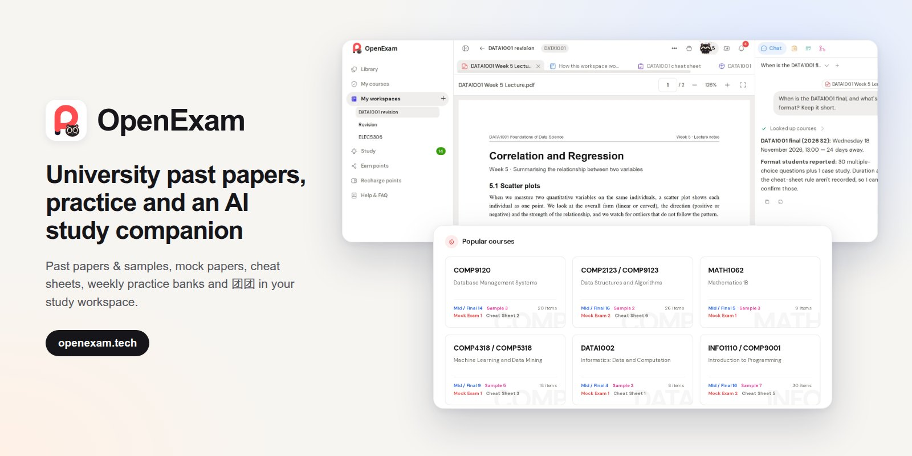

# OpenExam · USYD past papers, practice & cheat sheets

  

  <a href="https://openexam.tech"><strong>openexam.tech</strong></a> ·
  <a href="https://openexam.tech/library"><strong>Library</strong></a> ·
  <a href="https://openexam.tech/feedback"><strong>Feedback</strong></a>

[OpenExam](https://openexam.tech) is a past-exam platform for university students: past papers and official samples, mock papers, cheat sheets and weekly practice question banks for University of Sydney (USYD) units such as COMP2123, INFO1110, DATA1001, MATH1061, ECON1001 and STAT5002, with an AI study companion in a revision workspace. UNSW and UQ courses are in the catalogue too.

This repository was USYD Revision Hub. It now points to OpenExam, where all new material is published.

## OpenExam 是什么

OpenExam 是大学往年考试资料平台，以悉尼大学（USYD）为主，也收录 UNSW 和 UQ 的课程。

- **往年卷和官方样卷**：按课程、学期整理。
- **模拟卷**：按这门课考试的题型、范围和长度出的整套模拟卷，带答案。
- **Cheat sheet**：往届同学为考试做的速查表，可以当作你自己那份的起点。
- **按周练习题库**：跟着课程周次做题。
- **团团复习空间**：把 lecture PDF、笔记和往年卷放进一门课的空间，看不懂就问 AI 学习伙伴团团，它会按当前这一页找练习题和往年题。
- **新人礼**：新用户选一门课，免费领一批资料。

**What you get:** past papers and official samples, mock papers, cheat sheets, weekly practice banks, a study workspace with 团团 (TuanTuan), an AI companion that explains the page you are on and finds matching practice, and free starter materials for new users.

## 开始使用 · Start

打开 [openexam.tech/library](https://openexam.tech/library)，搜索你的课程代码（例如 `COMP2123`）。

Open [openexam.tech/library](https://openexam.tech/library) and search your unit code.

## 贡献资料 · Contribute

在 OpenExam 上传你手里的往年卷或复习资料，审核通过后获得积分，可以用来解锁其他资料。

Upload past papers or revision material on OpenExam; accepted contributions earn points you can spend on other materials.

## 关于本仓库 · About this repo

[`courses/`](./courses/) 保存了 USYD Revision Hub 时期公开的 26s1 免费 cheat sheet 和期末练习 PDF，不再更新。每门课的最新资料在它的 OpenExam 页面上，见文末课程列表。

[`courses/`](./courses/) keeps the free 26s1 cheat sheets and final practice PDFs from USYD Revision Hub. It is no longer updated; each course's current material is on its OpenExam page (see the course list below).

## 学术诚信与版权 · Academic integrity & copyright

OpenExam is an independent student project. It is not affiliated with, endorsed by, or maintained by the University of Sydney or any other university.

Use these materials for study and revision only, together with your unit outline and official course material. Follow your unit coordinator's instructions, your university's academic integrity policy, and copyright requirements. Do not submit Canvas-only files, current assessments or answers, or other students' work to this repo.

If you are a copyright owner, instructor, or original author and believe something should not be public, open a [GitHub issue](https://github.com/tomas-bear/OpenExam-USYD/issues) with the file path, or contact us via [openexam.tech/feedback](https://openexam.tech/feedback). After review, the material will be removed, replaced with a link, or updated with proper attribution.

## License

Unless otherwise stated, original text in this repository is shared under CC BY-NC-SA 4.0.

Third-party and university materials remain the property of their respective rights holders and are not automatically covered by this license.

## Course list

26 USYD courses with free PDFs in this repo (26s1 archive)

| Area | Course | In this repo | Latest |
| --- | --- | --- | --- |
| Business / Analytics | [`BUSS6002`](./courses/BUSS6002/) Data Science in Business | cheat sheet, practice | [OpenExam page](https://openexam.tech/course/ecc65ddd-7629-4b73-a2e8-e25e41e405d2) |
| Computer Science / Data / IT | [`COMP2123/9123`](./courses/COMP2123-COMP9123/) Data Structures and Algorithms | cheat sheet, practice | [OpenExam page](https://openexam.tech/course/af0b9225-83cc-4012-bcbc-33d3dbb81779) |
| Computer Science / Data / IT | [`COMP3308`](./courses/COMP3308/) Introduction to Artificial Intelligence | cheat sheet, practice | [OpenExam page](https://openexam.tech/course/dcd41e7a-f8bf-4fbf-a8af-fac6aa2e9c59) |
| Computer Science / Data / IT | [`COMP4446/5046`](./courses/COMP5046/) Natural Language Processing | cheat sheet, practice | [OpenExam page](https://openexam.tech/course/34c9fb06-2cc2-4587-a002-ad2c87deed26) |
| Computer Science / Data / IT | [`COMP5310`](./courses/COMP5310/) Principles of Data Science | cheat sheet, practice | [OpenExam page](https://openexam.tech/course/dbe667d2-663a-4f75-9f33-db0da317222f) |
| Computer Science / Data / IT | [`COMP4329/5329`](./courses/COMP5329/) Deep Learning | practice | [OpenExam page](https://openexam.tech/course/5c314fa8-74d1-4735-96fd-405cf27da375) |
| Computer Science / Data / IT | [`COMP5339`](./courses/COMP5339/) Data Engineering | practice | [OpenExam page](https://openexam.tech/course/527af6b3-c845-41d4-b8d9-22adc1aa35b5) |
| Computer Science / Data / IT | [`COMP4405/5405`](./courses/COMP5405/) Digital Media Computing | cheat sheet, practice | [OpenExam page](https://openexam.tech/course/3501f906-7b0d-4c83-b255-737d6c2c6901) |
| Computer Science / Data / IT | [`COMP4425/5425`](./courses/COMP5425/) Multimedia Retrieval | practice | [OpenExam page](https://openexam.tech/course/f68a6717-b16c-4f83-8cf5-a7f8089ed2b8) |
| Computer Science / Data / IT | [`INFO1110/COMP9001`](./courses/COMP9001/) Introduction to Programming | cheat sheet, practice | [OpenExam page](https://openexam.tech/course/422db24e-0096-4d57-bd06-f8880f128500) |
| Computer Science / Data / IT | [`INFO1113/COMP9003`](./courses/COMP9003/) Object-Oriented Programming | practice | [OpenExam page](https://openexam.tech/course/1b52136b-86c7-44c1-803a-796244c6380a) |
| Computer Science / Data / IT | [`COMP9120`](./courses/COMP9120/) Database Management Systems | cheat sheet, practice | [OpenExam page](https://openexam.tech/course/4f533351-6c9c-490c-8198-e58cce249219) |
| Computer Science / Data / IT | [`COMP9601`](./courses/COMP9601/) Computer and Network Organisation | practice | [OpenExam page](https://openexam.tech/course/a8428388-7ede-4de2-96cf-9feed21ab4d9) |
| Computer Science / Data / IT | [`DATA1001/1901`](./courses/DATA1001/) Foundations of Data Science | cheat sheet, practice | [OpenExam page](https://openexam.tech/course/48a2b53e-952a-4fa4-ae42-a5e4e3dfbe99) |
| Computer Science / Data / IT | [`DATA2001`](./courses/DATA2001/) Data Science, Big Data and Data Variety | cheat sheet, practice | [OpenExam page](https://openexam.tech/course/389e1a45-01a8-4505-af89-eebd8a96dd6f) |
| Economics / Econometrics | [`ECON1001`](./courses/ECON1001/) Introductory Microeconomics | cheat sheet, practice | [OpenExam page](https://openexam.tech/course/a3855f60-a6de-4589-8f58-826a44700d59) |
| Economics / Econometrics | [`ECON1002`](./courses/ECON1002/) Introductory Macroeconomics | cheat sheet, practice | [OpenExam page](https://openexam.tech/course/e62b97a5-6d15-45ce-8a3b-62e1931d90b2) |
| Engineering | [`ELEC5620`](./courses/ELEC5620/) Model Based Software Engineering | cheat sheet, practice | [OpenExam page](https://openexam.tech/course/72d8e251-198a-445f-8086-974f66a05d35) |
| Computer Science / Data / IT | [`INFO5990`](./courses/INFO5990/) Professional Practice in IT | cheat sheet, practice | [OpenExam page](https://openexam.tech/course/684a8e4f-74d8-4c13-8c0f-2c243c050b87) |
| Computer Science / Data / IT | [`INFO6007`](./courses/INFO6007/) Project Management in IT | practice | [OpenExam page](https://openexam.tech/course/7b5c1670-02fb-4793-8ac2-ea08beb9c74e) |
| Math / Stats / Science | [`MATH1061`](./courses/MATH1061/) Mathematics 1A | cheat sheet, practice | [OpenExam page](https://openexam.tech/course/fe546a4c-64a6-401c-871d-753685bd2b4c) |
| Business / Analytics | [`QBUS3820`](./courses/QBUS3820/) Machine Learning and Data Mining in Business | practice | [OpenExam page](https://openexam.tech/course/928e3da7-f9be-41e0-b96b-c6befa7fb75c) |
| Business / Analytics | [`QBUS6810`](./courses/QBUS6810/) Machine Learning for Business | cheat sheet, practice | [OpenExam page](https://openexam.tech/course/f2196623-235c-456c-867c-b96064b3b93b) |
| Business / Analytics | [`QBUS2820/6840`](./courses/QBUS6840/) Predictive Analytics | cheat sheet, practice | [OpenExam page](https://openexam.tech/course/3ca3986f-6041-4480-942f-f9c5803020b9) |
| Math / Stats / Science | [`STAT5002`](./courses/STAT5002/) Introduction to Statistics | cheat sheet, practice | [OpenExam page](https://openexam.tech/course/0c95fd2c-5417-49a9-b09a-6e43a0c423e5) |
| Math / Stats / Science | [`STAT5003`](./courses/STAT5003/) Computational Statistical Methods | cheat sheet, practice | [OpenExam page](https://openexam.tech/course/be575121-d57b-4f1e-86f8-714494a9aeca) |

Courses not listed here may already be on [OpenExam](https://openexam.tech/library); search by unit code.

